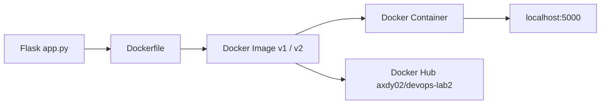
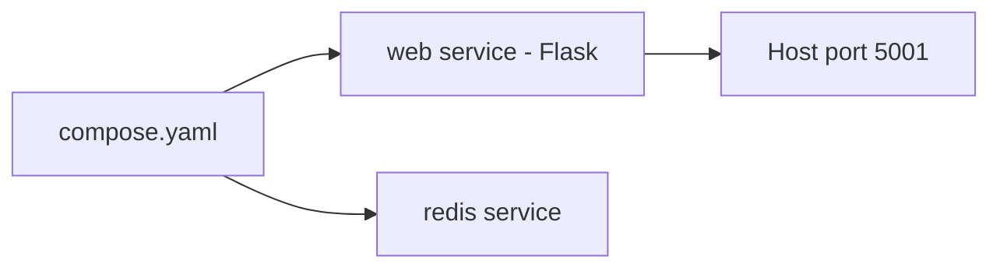
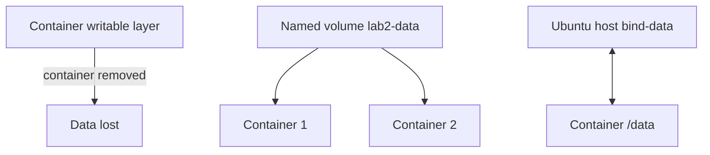
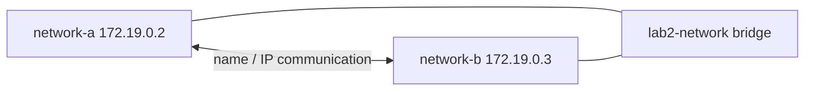
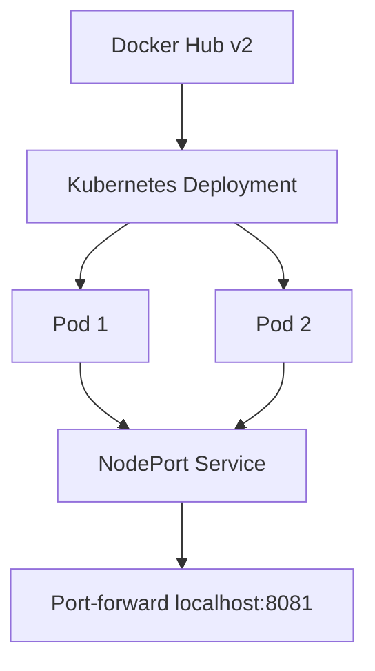
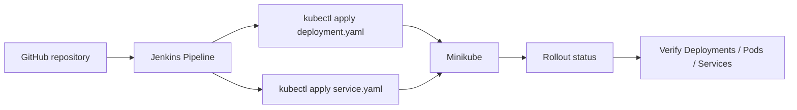

# Architecture — Lab 2

## Containerization Flow

## Docker Compose Flow

## Docker Storage

## Docker Network

## Kubernetes Architecture

## Jenkins Continuous Deployment

The Jenkins pipeline automates manifest application and rollout verification. The captured evidence proves a successful Jenkins deployment run; it is not used as evidence of a webhook unless a webhook is separately configured.
