# Lab 2 Evidence Gallery

The screenshots below were captured during the actual Lab 2 execution and extracted from the supplied evidence document. They are ordered to follow the lab workflow.

## Q1 — Docker Environment and Containerization

### 1. Ubuntu 26.04 LTS
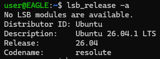

### 2. Docker and Docker Compose versions
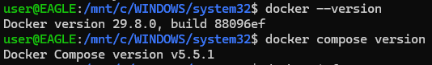

### 3. Docker Hello World
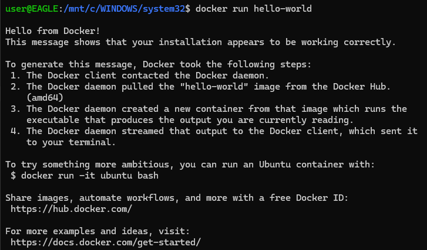

### 4. Docker container listing
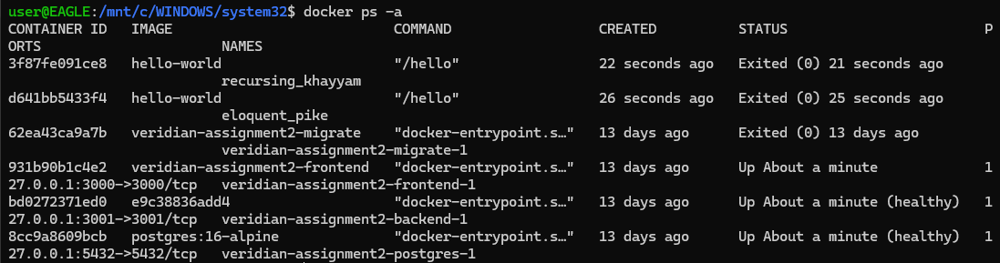

### 5. Docker build of `devops-lab2:v1`
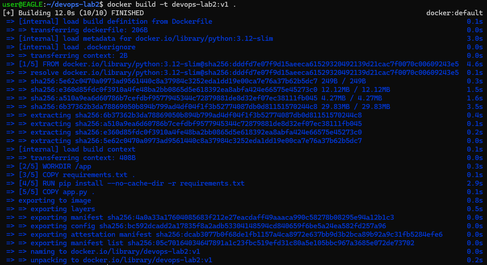

### 6. Docker image layers with `docker history`
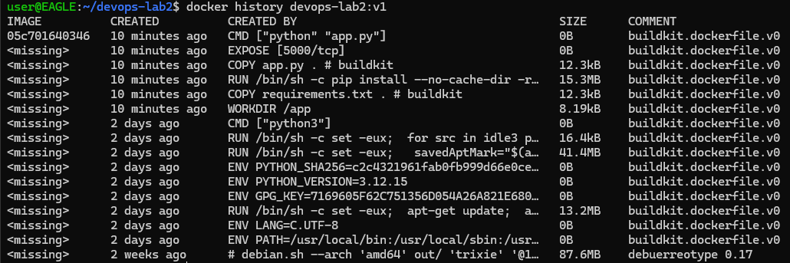

### 7. Application container running
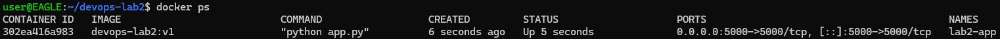

### 8. Flask application verified with curl
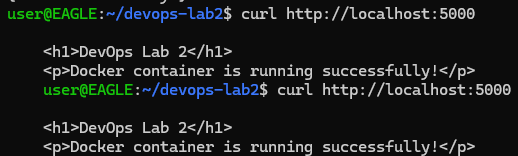

### 9. Flask application in browser at localhost:5000
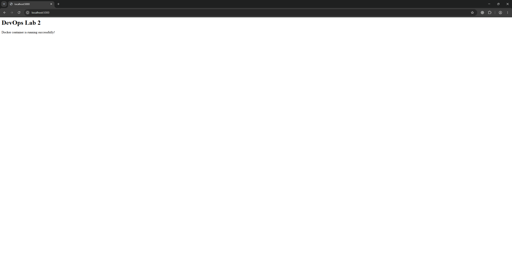

## Q2 — Container / Image Management and Compose

### 10. Container status
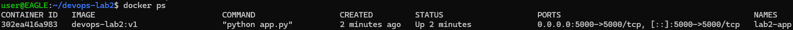

### 11. Filtered application container listing
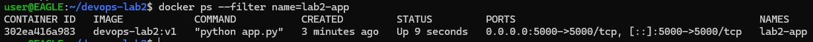

### 12. Docker image tags: `v1` and `latest`
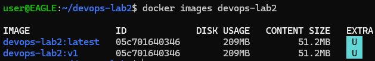

### 13. Docker Compose Flask + Redis services
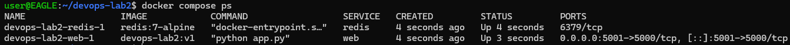

### 14. Docker Hub push of v1
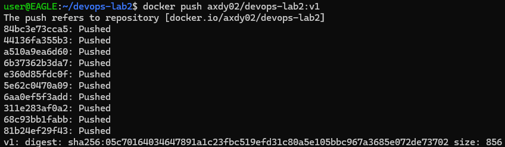

### 15. Docker Hub repository
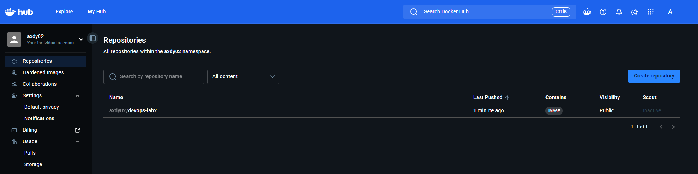

## Q3 — Docker Storage

### 16. Data loss after container deletion
The file existed inside `storage-test`; after deleting that container, a new Ubuntu container returned `No such file or directory`.

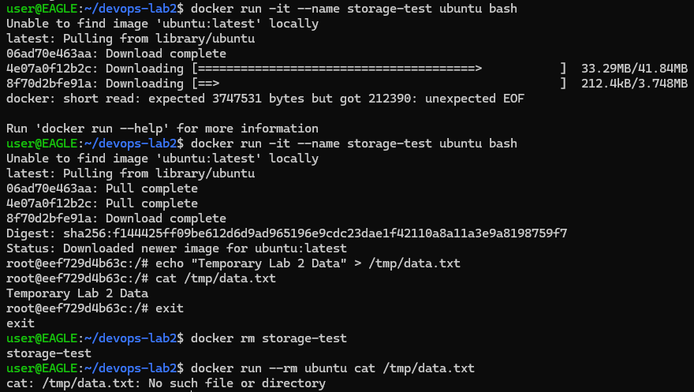

### 17. Named-volume persistence
The source container was removed, then a new container mounted `lab2-data` and successfully printed `Persistent Lab 2 Data`.

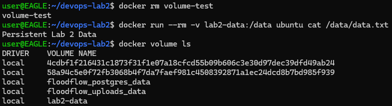

### 18. Bind mount in both directions
The host-created file was read in the container, and the container-created file was read from the Ubuntu host.

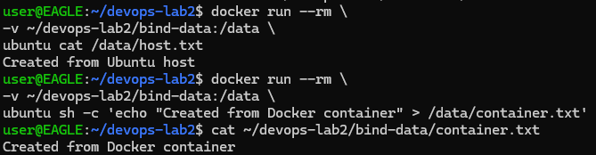

## Q4 — Docker Networking

### 19. Communication by container name
`network-a` successfully pinged `network-b` with 0% packet loss.

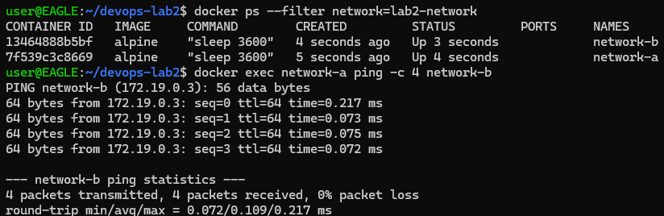

### 20. Communication by container IP address
The IP of `network-b` was inspected and successfully pinged directly.

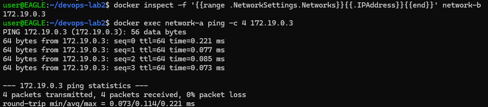

### 21. Docker network inspection
`lab2-network` shows both containers on the same bridge subnet.

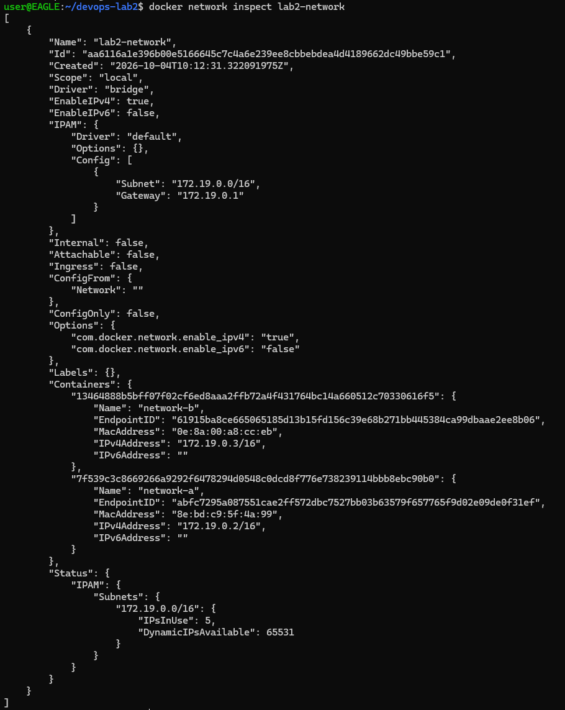

## Q5 — Kubernetes / Minikube Deployment

### 22. kubectl and Minikube versions
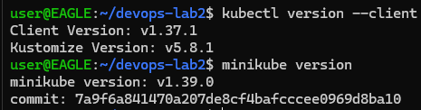

### 23. Minikube node in Ready state
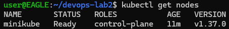

### 24. Deployment, pods and Service
The Deployment is 2/2 ready, two pods are running, and the NodePort Service exposes `5000:30080/TCP`.

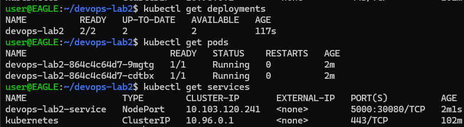

### 25. Kubernetes Service port-forward
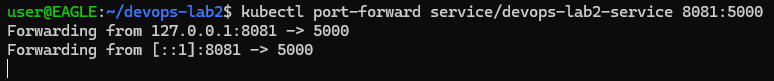

## Q6 — Scaling, Rolling Update and Rollback

### 26. Scaling to four replicas
The Deployment shows 4/4 ready and four application pods running.

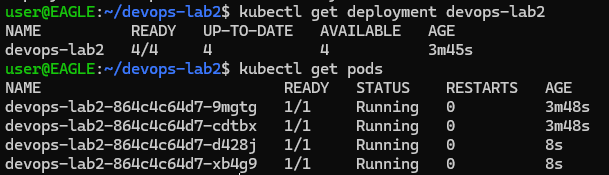

### 27. Push Docker image v2
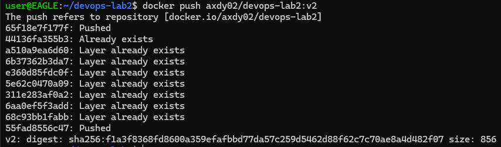

### 28. Rolling update to v2
The Deployment image was changed to v2 and rollout status shows the progressive replacement of old replicas.

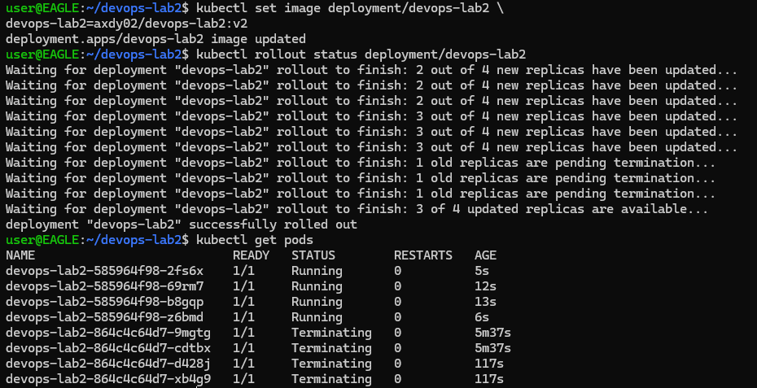

### 29. Version 2 application in browser
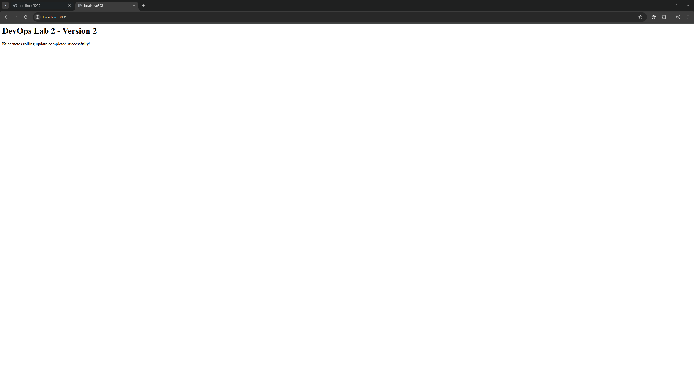

### 30. Rollback to previous revision
Rollout history was inspected, rollback completed successfully, and the image was verified as v1.

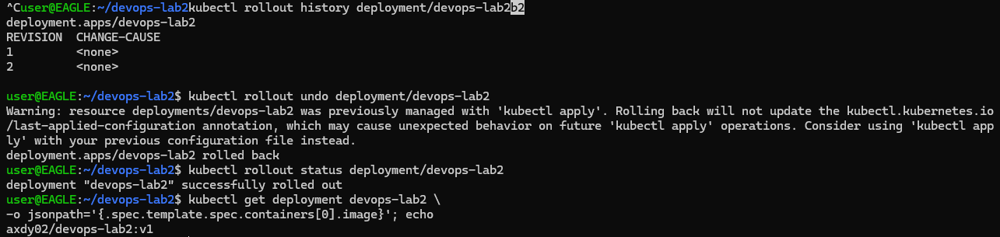

## Q8 — Git / GitHub Documentation Evidence

### 31. Git commit and push
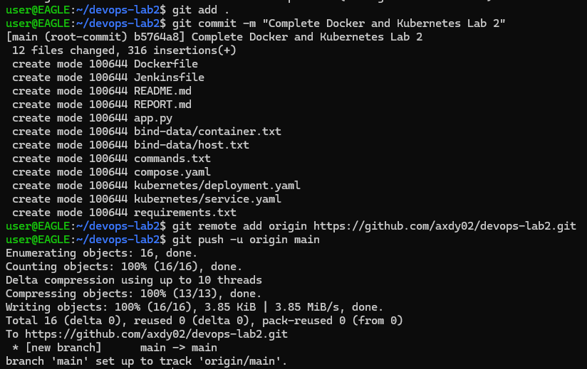

### 32. GitHub repository before local push completed
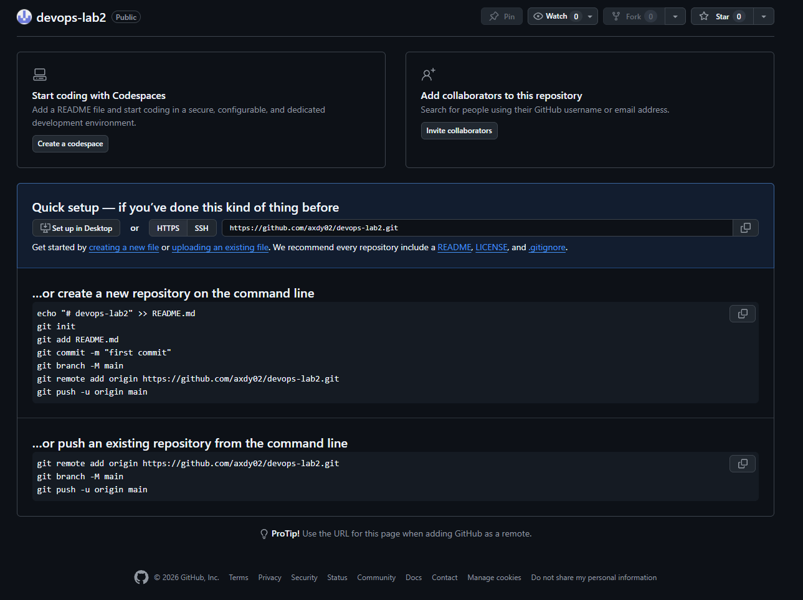

### 33. GitHub repository with Lab 2 files
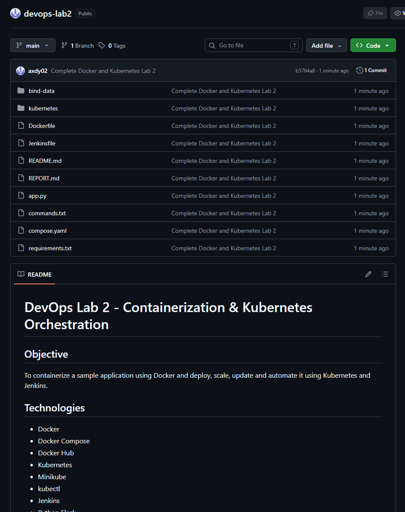

## Q7 — Jenkins Continuous Deployment

### 34. Jenkins `devops-lab2` successful build
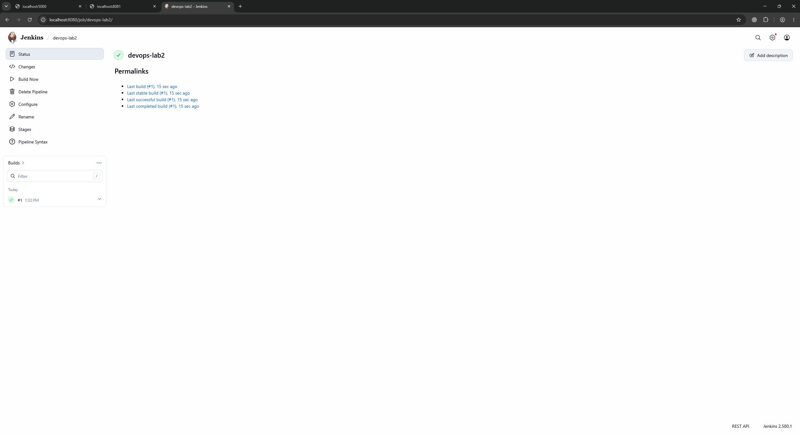

### 35. Jenkins continuous deployment console
The console shows GitHub checkout, `kubectl apply`, rollout progress, Kubernetes verification, the success message and `Finished: SUCCESS`.

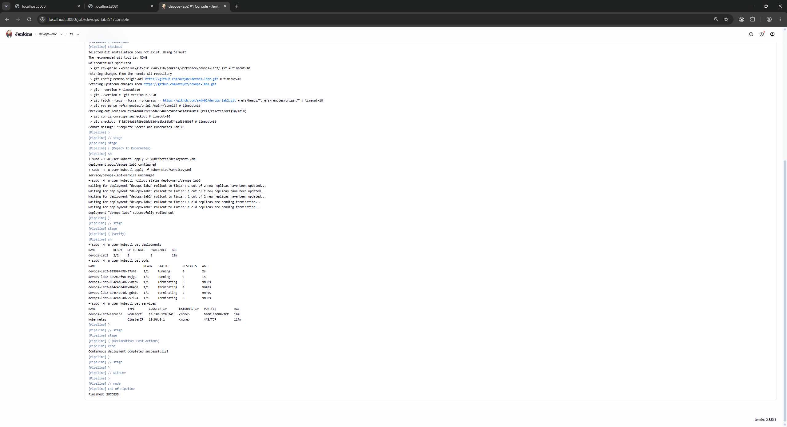

### 36. Final Kubernetes v2 state
The final state shows 2/2 Deployment replicas, two running pods and image `axdy02/devops-lab2:v2`.

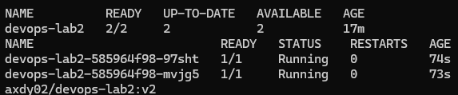

---

## Original Evidence Document

The original compiled evidence document is also included for completeness:

[`docs/source/Lab2-Evidence.docx`](source/Lab2-Evidence.docx)
