# Lab 4 Screenshot Evidence

This gallery contains all **40 original screenshots** extracted from `Devops lab 4(1).docx`. IDs S01-S40 follow the image order in that document. Captions describe the visible results; the image content is unchanged.

[Project overview](../README.md) · [Detailed report](../REPORT.md) · [Remaining checks](FINAL-CHECKS.md)

| Question | Topic | Screenshot IDs | PDF |
| --- | --- | --- | --- |
| 1 | Automated testing and pipeline gates | [S01-S11](#s01) | [Question 1](proofs/question-1.pdf) |
| 2 | Blue-Green deployment | [S12-S16](#s12) | [Question 2](proofs/question-2.pdf) |
| 3 | Canary deployment | [S17-S20](#s17) | [Question 3](proofs/question-3.pdf) |
| 4 | GitOps delivery | [S21-S28](#s21) | [Question 4](proofs/question-4.pdf) |
| 5 | Secret management | [S29-S32](#s29) | [Question 5](proofs/question-5.pdf) |
| 6 | Disaster recovery | [S33-S39](#s33) | [Question 6](proofs/question-6.pdf) |
| 7 | Report and repository documentation | [S40](#s40) | [Question 7](proofs/question-7.pdf) |

Question 7 includes the complete screenshot appendix. S39 is also included in the Question 2 PDF as later recovery evidence, with its outage context retained.

## Question 1 Automated testing and pipeline gates

### S01

**Six local tests pass**

Pytest collects six tests: three application route tests and three arithmetic unit tests. All six pass in the displayed run.

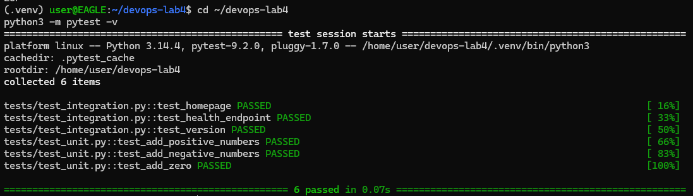

*Source: original Word image1.png.*

### S02

**Initial repository push**

The main branch is pushed successfully to axdy02/devops-lab4 on GitHub and configured to track origin/main.

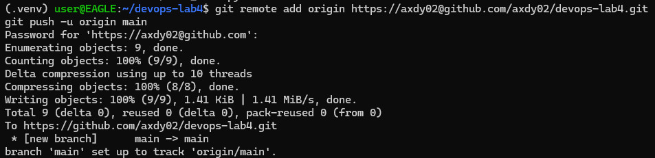

*Source: original Word image2.png.*

### S03

**Initial project files on GitHub**

The repository contains the tests directory, Jenkinsfile, application and requirements. This is an early capture, before the README was added.

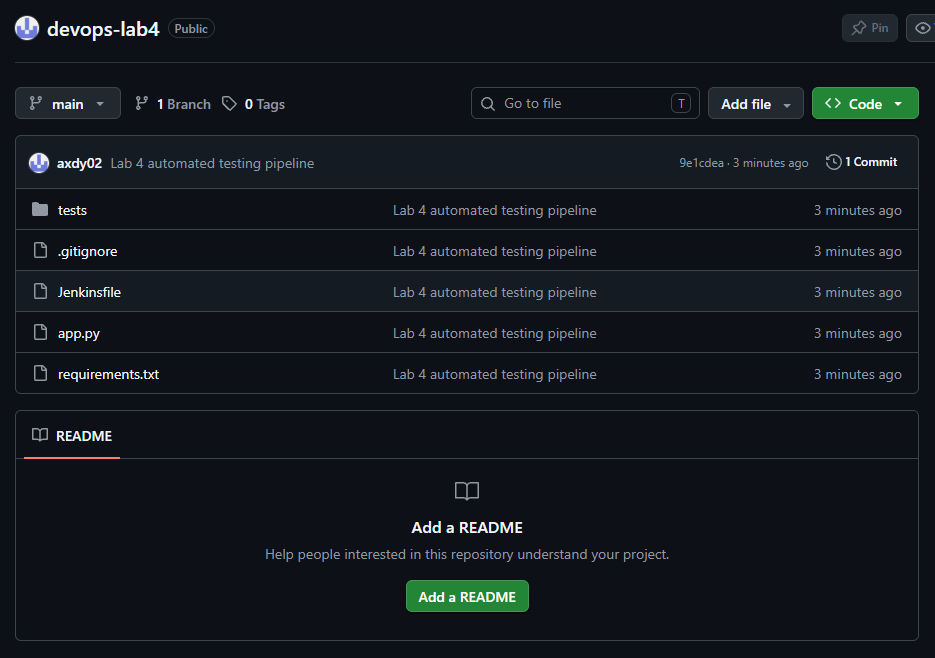

*Source: original Word image3.png.*

### S04

**Jenkins starts the first pipeline run**

The Jenkins console shows the first build checking out the project repository. The result of this run is shown in S05.

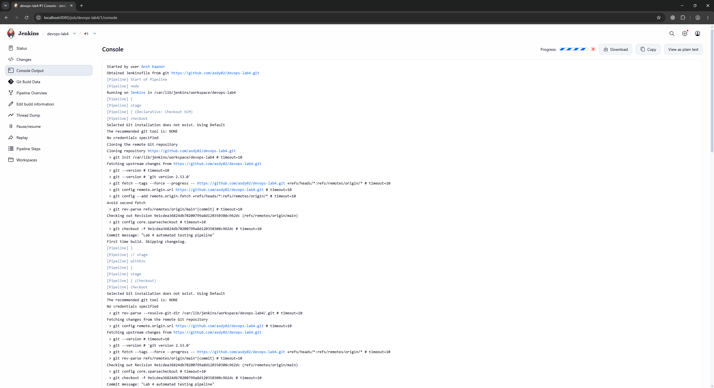

*Source: original Word image4.png.*

### S05

**Passing tests allow the approval stage**

The first build passes three unit tests and three integration tests, executes the Deployment Gate message and finishes SUCCESS. The gate shown is an approval message; this capture does not show an application deployment.

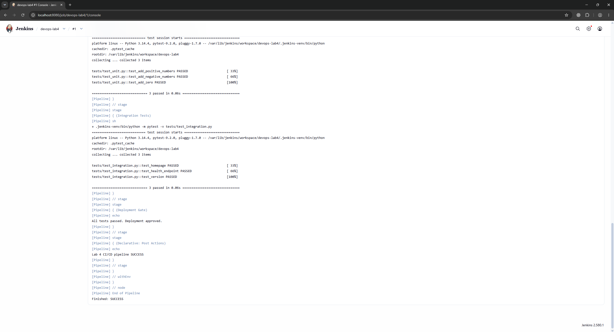

*Source: original Word image5.png.*

### S06

**A deliberate failing assertion is committed**

The expected result for add(2, 3) is changed from 5 to 999 to exercise the failure path, then committed and pushed.

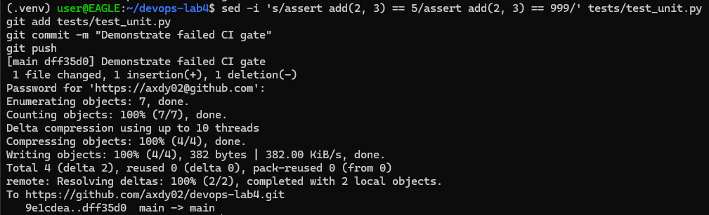

*Source: original Word image6.png.*

### S07

**Jenkins checks out the failure demonstration**

The next Jenkins run checks out the commit that deliberately introduces the failing assertion. The failure and skipped stages appear in S08.

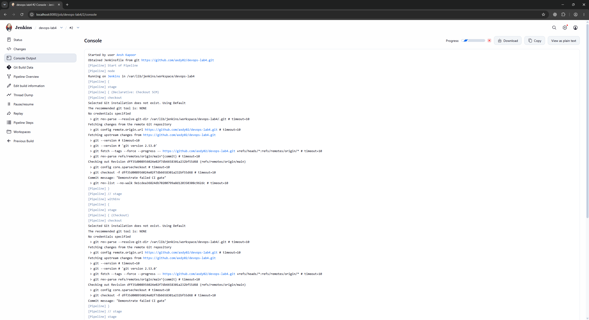

*Source: original Word image7.png.*

### S08

**A failed test blocks downstream stages**

The deliberate assertion fails. Jenkins skips Integration Tests and Deployment Gate due to the earlier failure, prints the blocked message and finishes FAILURE.

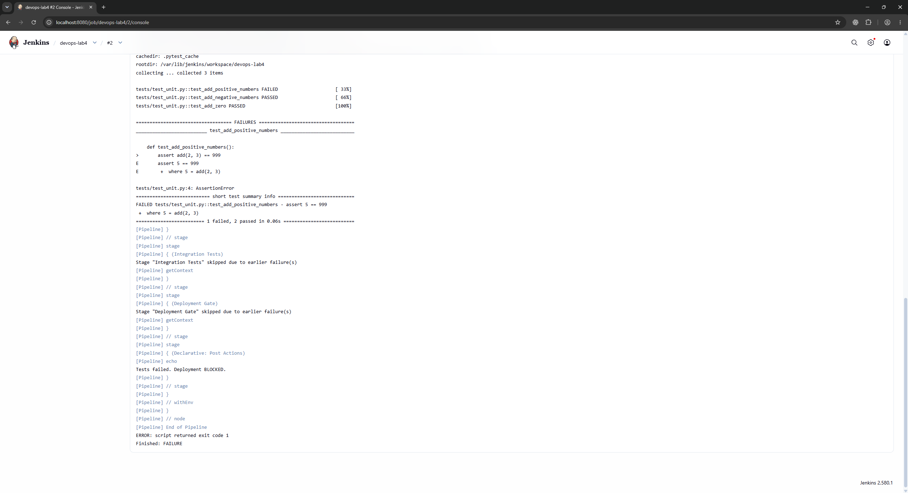

*Source: original Word image8.png.*

### S09

**The correct assertion is restored**

The expected result is restored from 999 to 5. The passing test change is committed and pushed to the main branch.

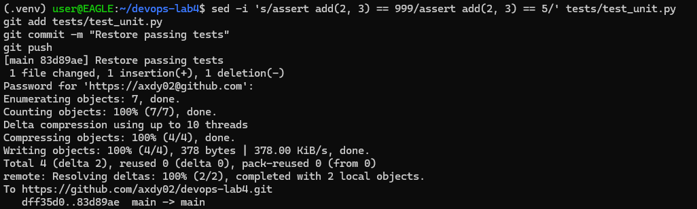

*Source: original Word image9.png.*

### S10

**Jenkins checks out the restored tests**

The next Jenkins console records checkout of the restored-tests commit. Its passing result appears in S11.

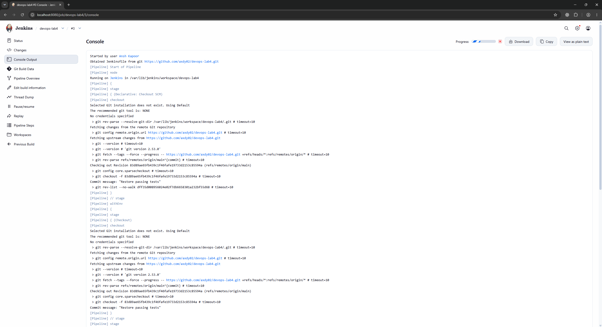

*Source: original Word image10.png.*

### S11

**The restored pipeline succeeds**

Three unit tests and three integration tests pass after the correction. The approval stage runs and Jenkins finishes SUCCESS.

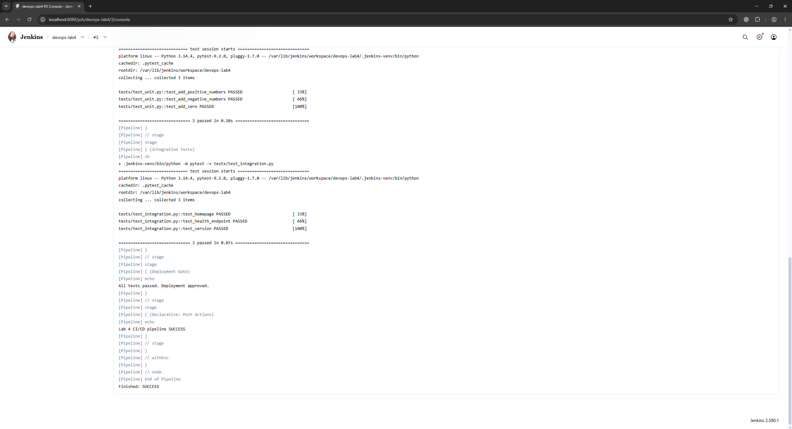

*Source: original Word image11.png.*

## Question 2 Blue-Green deployment

### S12

**Blue and Green services start**

Docker Compose builds the Blue and Green application images and starts both application containers and nginx. The proxy publishes localhost port 8086.

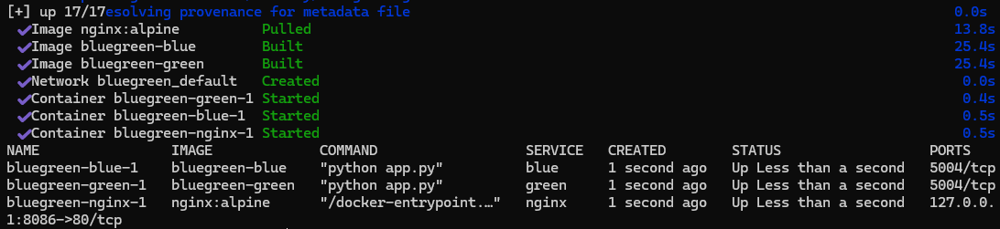

*Source: original Word image12.png.*

### S13

**The initial endpoint serves version v1**

The running Blue-Green services are listed and a request to localhost:8086 returns the DevOps Lab 4 application with version v1.

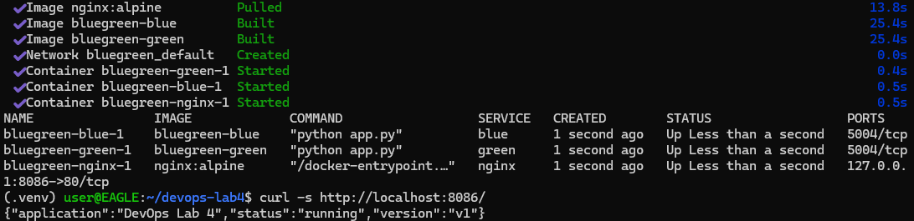

*Source: original Word image13.png.*

### S14

**Green is healthy but the endpoint remains on v1**

The direct health check inside Green returns healthy. The host configuration is edited toward Green and nginx validation/reload reports success, but the final public-endpoint response still says v1.

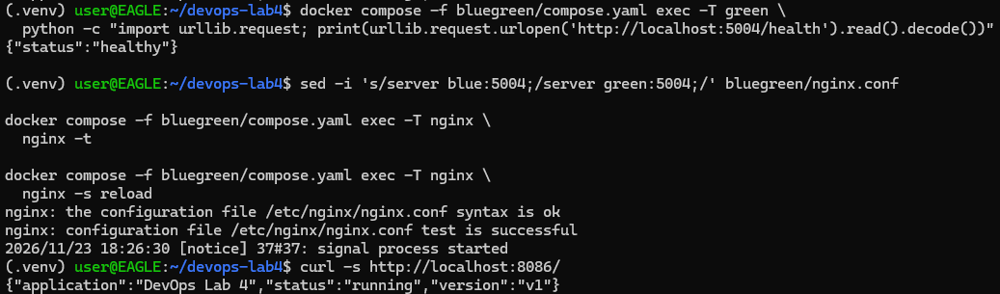

*Source: original Word image14.png.*

### S15

**The visible request sample returns HTTP 200**

Requests 72 through 100 are visible. Each reports v1 and HTTP 200. The capture does not include requests 1 through 71 or a transition to v2.

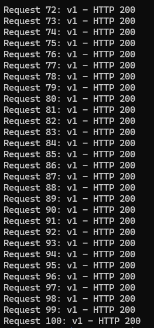

*Source: original Word image15.png.*

### S16

**The configuration is edited back toward Blue**

The host configuration is changed from Green to Blue and nginx syntax validation and reload succeed. A post-change endpoint response is not included in this capture.

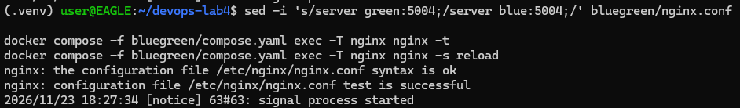

*Source: original Word image16.png.*

## Question 3 Canary deployment

### S17

**The Canary services start**

The Canary Blue, Green and nginx containers start. The endpoint on localhost:8087 returns the application with version v1.

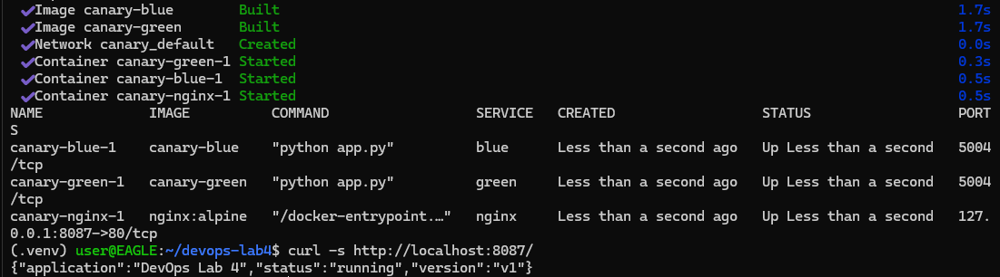

*Source: original Word image17.png.*

### S18

**A 100-request sample confirms the 90 to 10 split**

The script counts version values returned by 100 requests. The observed result is v1: 90 and v2: 10, giving a 10 percent share for v2 in this sample.

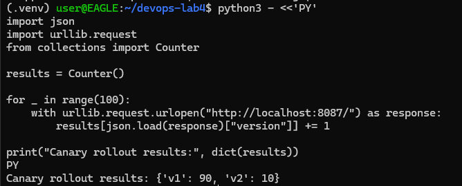

*Source: original Word image18.png.*

### S19

**A change to 70 and 30 weights is attempted**

The host configuration weights are edited from 90/10 to 70/30. Nginx syntax validation and reload report success; these command results alone do not establish the resulting traffic distribution.

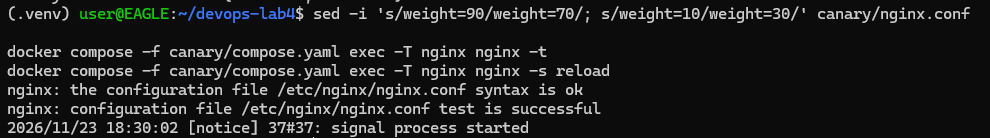

*Source: original Word image19.png.*

### S20

**The later sample still reports 90 to 10**

Although the script labels its output Canary rollback results, the actual counts are still v1: 90 and v2: 10. This does not demonstrate a 70/30 traffic split or a complete rollback to v1.

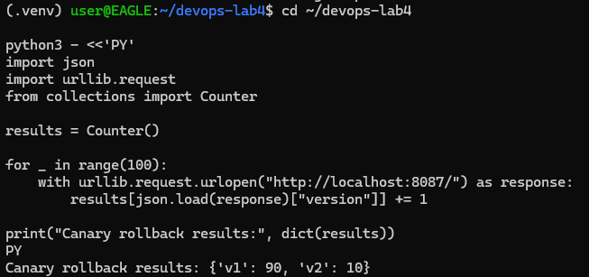

*Source: original Word image20.png.*

## Question 4 GitOps delivery

### S21

**Argo CD components are running**

The seven listed Argo CD pods are each Ready 1/1 and Running in the argocd namespace.

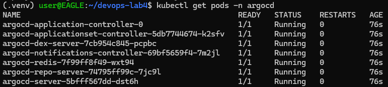

*Source: original Word image21.png.*

### S22

**The Argo CD login page is reachable**

The Argo CD web interface is accessible through the local browser. This is setup evidence for the GitOps workflow.

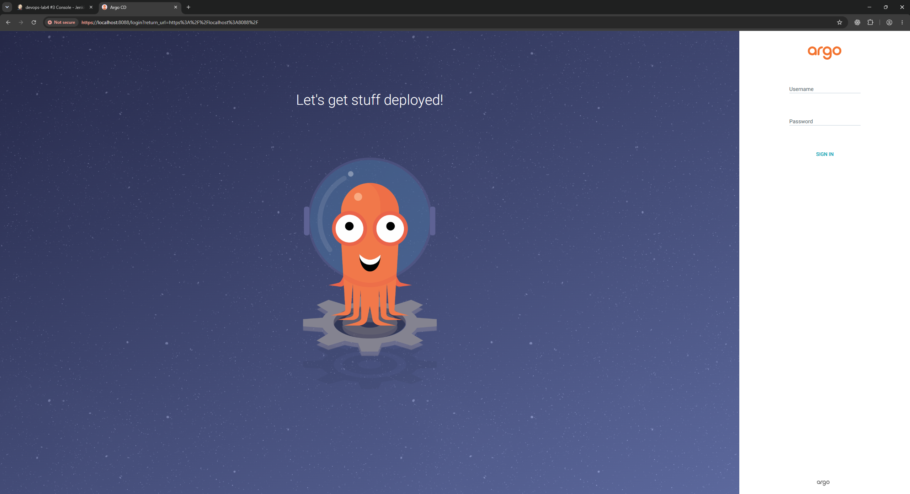

*Source: original Word image22.png.*

### S23

**The initial Argo CD applications view**

The applications dashboard is shown before the GitOps application is created. No applications are listed yet.

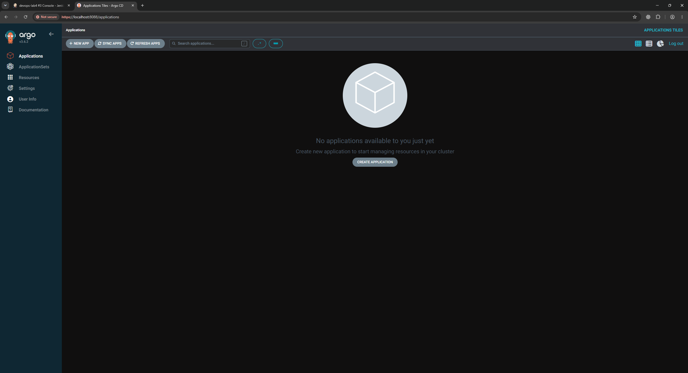

*Source: original Word image23.png.*

### S24

**Declarative deployment files are committed**

The deployment and service manifests under gitops/manifests are committed and pushed to GitHub.

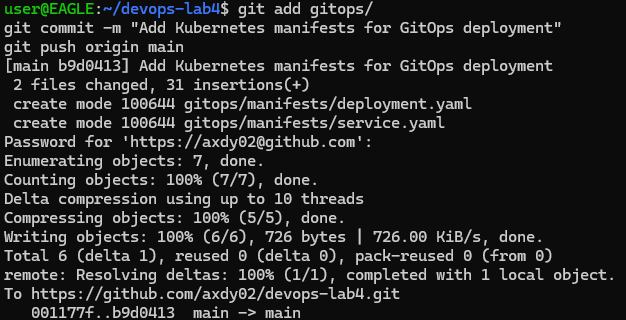

*Source: original Word image24.png.*

### S25

**The GitOps application is Healthy and Synced**

The gitops-demo application card shows Healthy and Synced, tracks main, uses gitops/manifests, and targets the default namespace of the in-cluster destination.

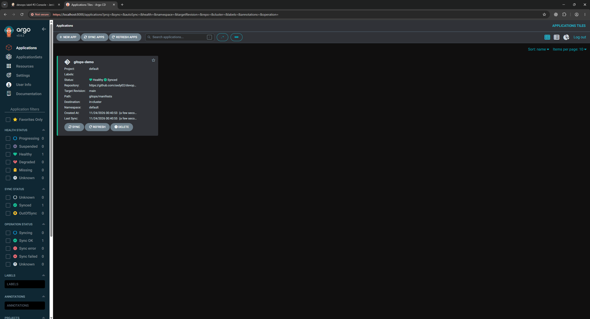

*Source: original Word image25.png.*

### S26

**The initial deployment has two ready replicas**

Kubectl shows gitops-demo at 2/2 ready, two Running pods, and a ClusterIP service exposing port 80.

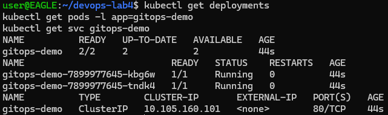

*Source: original Word image26.png.*

### S27

**The two-replica state is checked again**

A subsequent deployment and pod listing still shows two ready replicas. This records the state before the later three-replica capture.

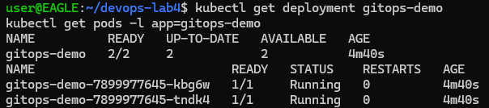

*Source: original Word image27.png.*

### S28

**Three replicas become ready**

The displayed deployment progresses from Ready 1/3 to 3/3 and lists three Running pods. The capture does not include the Git edit or a manual drift command that caused this transition.

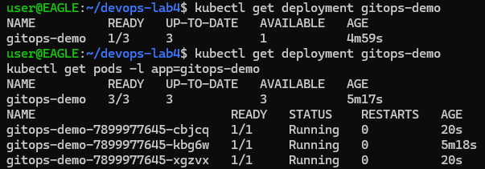

*Source: original Word image28.png.*

## Question 5 Secret management

### S29

**The Jenkins credential is registered**

The Jenkins credential list contains the ID lab4-api-key. The credential value is not displayed in this screenshot.

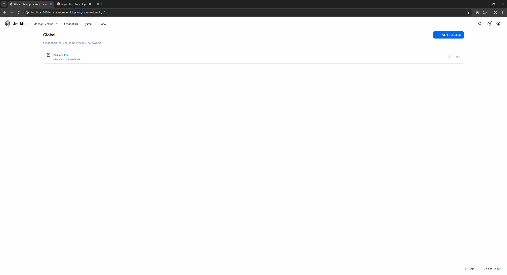

*Source: original Word image29.png.*

### S30

**Jenkins loads the credential without printing its value**

The Secure Secret Management stage uses withCredentials, enables masking for API_KEY, turns off shell tracing and prints successful validation messages. This is evidence of the demonstrated credential-loading check, not an external API authentication test.

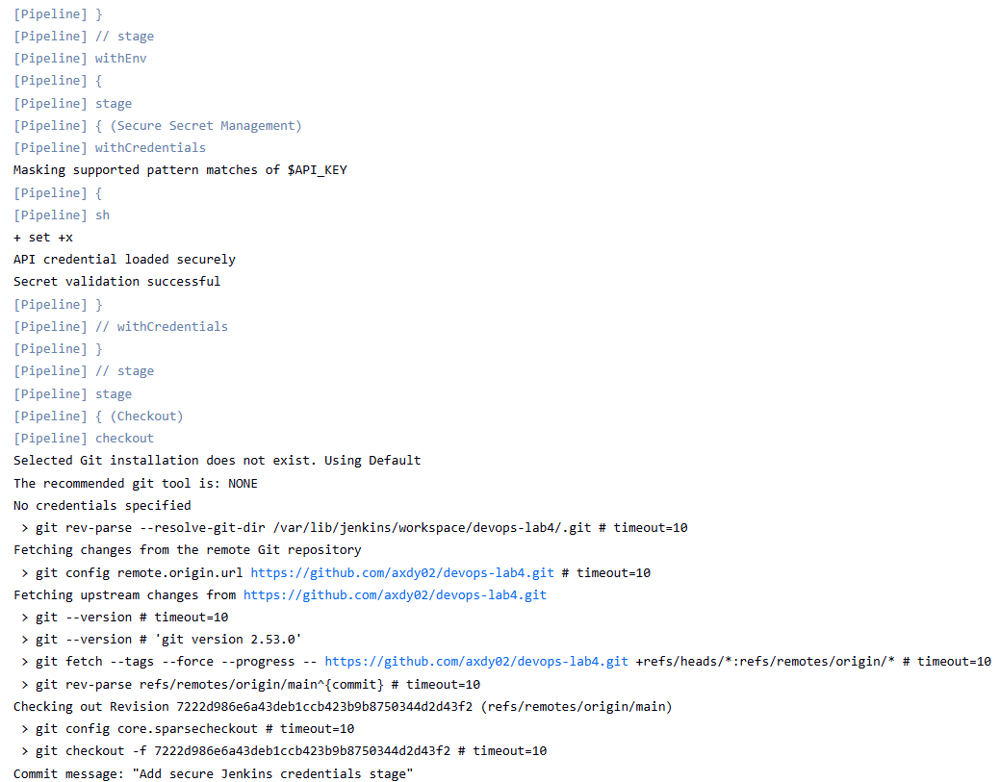

*Source: original Word image30.png.*

### S31

**The pipeline with the secret stage succeeds**

The build passes three unit tests and three integration tests, reaches the approval stage and finishes SUCCESS.

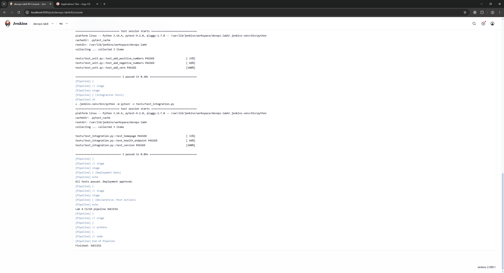

*Source: original Word image31.png.*

### S32

**A Kubernetes Pod confirms secret injection**

The lab4-secret-demo Pod is created, reaches Ready, prints Kubernetes Secret injected successfully, and is shown Running with Ready 1/1.

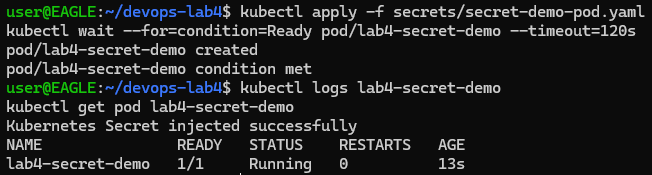

*Source: original Word image32.png.*

## Question 6 Disaster recovery

### S33

**The backup content and checksum are recorded**

The local backup file contains the lab disaster-recovery test record. Its SHA-256 checksum is printed for later comparison.

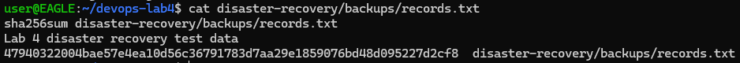

*Source: original Word image33.png.*

### S34

**The deleted test file is restored**

The test file is removed from the Pod, its absence is checked, and the saved file is copied back. The restored content is printed. The date +%s timer displays 0 seconds at whole-second resolution.

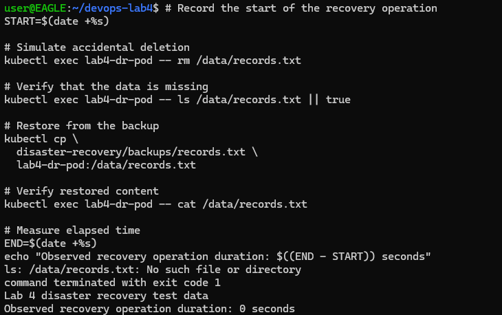

*Source: original Word image34.png.*

### S35

**The restored file matches the backup**

The SHA-256 values of the local backup and the restored Pod file are identical, supporting integrity of this restored test file.

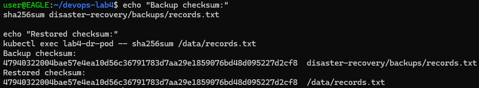

*Source: original Word image35.png.*

### S36

**Stopping Blue produces a visible outage**

The Blue application container is stopped. A request through nginx returns HTTP 504 Gateway Time-out.

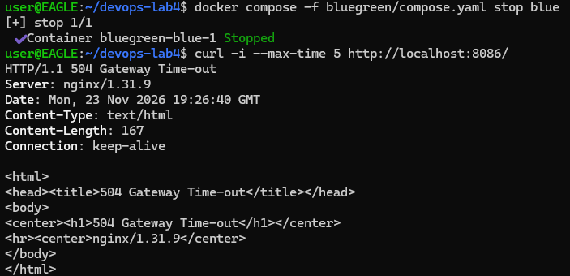

*Source: original Word image36.png.*

### S37

**The proxy still times out while Green is running**

The public endpoint again returns HTTP 504. Docker Compose lists Green and nginx as running, so a running alternate service alone has not restored endpoint service.

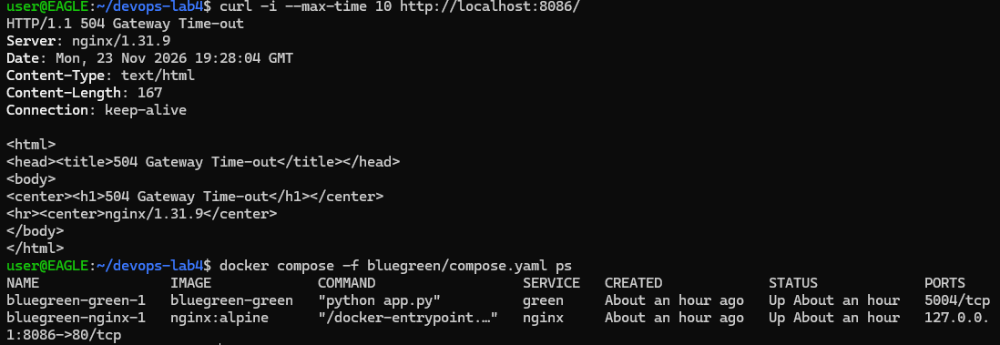

*Source: original Word image37.png.*

### S38

**Troubleshooting finds an upstream configuration problem**

A direct request to Green returns v2. The host file points to Green, but nginx validation still reports an unresolved Blue upstream and the endpoint returns HTTP 504.

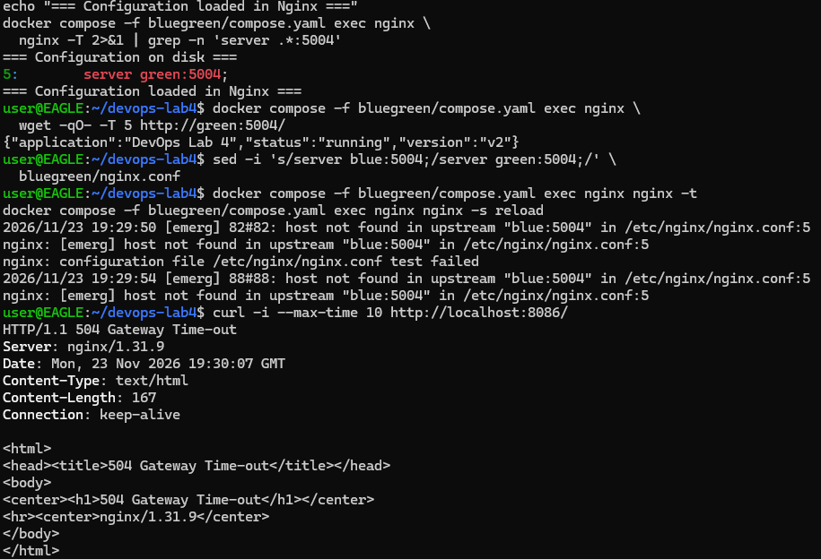

*Source: original Word image38.png.*

### S39

**The endpoint recovers on Green**

The configuration displayed inside nginx now uses Green. The endpoint returns HTTP 200 and version v2, with Green and nginx running. This is successful later manual recovery following the recorded outage.

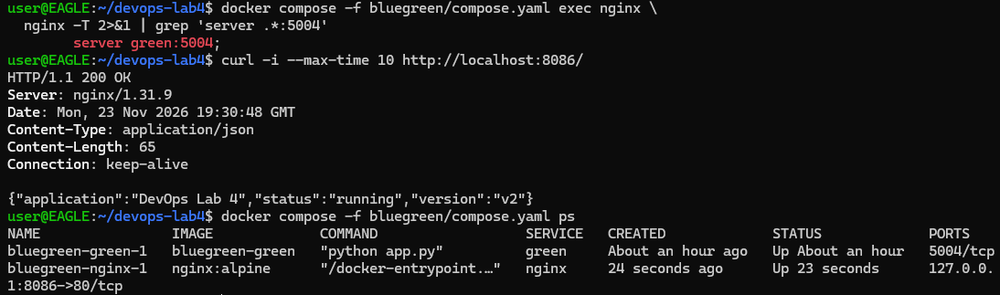

*Source: original Word image39.png.*

## Question 7 Report and repository documentation

### S40

**The final repository includes the documentation**

The GitHub capture shows README.md, REPORT.md and the rendered README. It also lists the deployment, GitOps, secret and test files. A disaster-recovery directory is not visible in this captured repository listing.

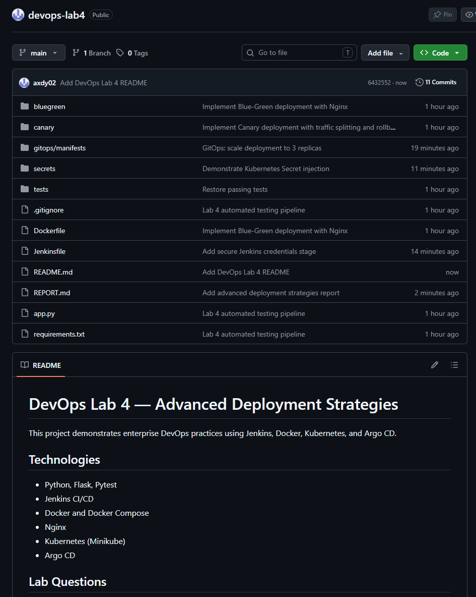

*Source: original Word image40.png.*

